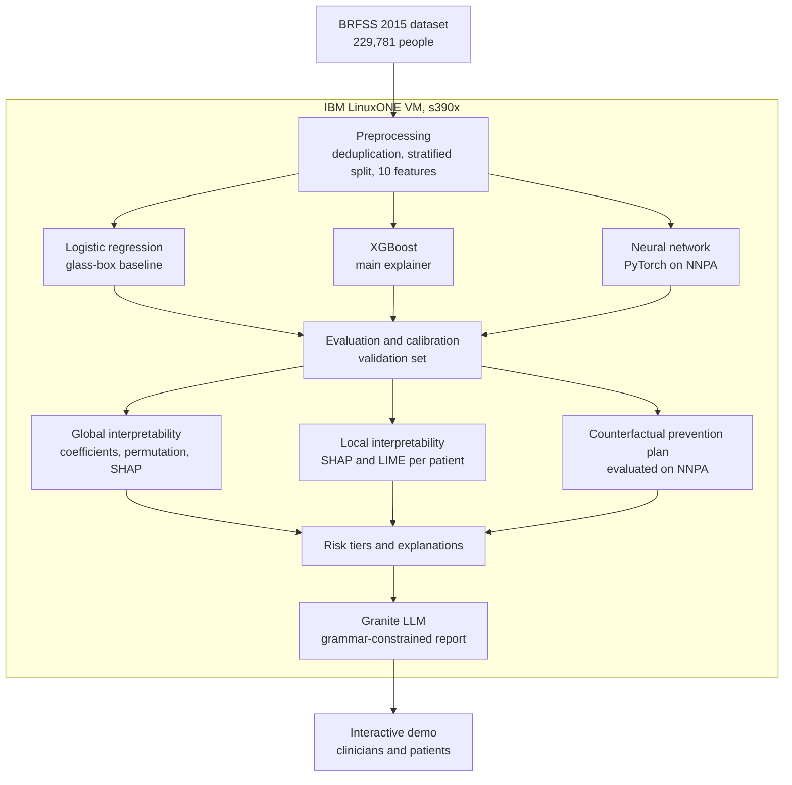

# Interpretable Heart Disease Risk AI on IBM LinuxONE

**Biodatitos_IBM Z Datathon 2026 Project**

An interpretable hybrid AI system that estimates a person's probability of heart disease, explains which factors drive the estimate, and builds a step-by-step prevention plan based on the factors the person can actually change. Everything runs on IBM LinuxONE, and the neural network runs on the IBM Telum II on-chip AI accelerator (NNPA).

**Datathon theme:** Real-Time AI for Critical Decisions (Healthcare Prioritisation), with a privacy angle from Theme 2: sensitive health data is processed without leaving the mainframe.

> Model-based estimates for screening and prioritization support. This is not a medical diagnosis tool.

---

## 1. The problem

Cardiovascular disease is the leading cause of death worldwide, yet many people do not know which of their conditions and habits put them at risk. Most machine learning models that estimate this risk behave as black boxes: they return a number without the reasons behind it, so clinicians cannot trust them and patients cannot act on them.

## 2. Our solution

For each person, the system answers three questions:

1. **What is my probability of heart disease?** A calibrated probability and a risk tier (Low, Moderate, High).
2. **Why?** The factors that raise or lower the estimate, explained with SHAP and LIME.
3. **What can I do?** A step-by-step prevention plan that only changes modifiable factors, showing how much each step lowers the estimate.



## 3. Why IBM LinuxONE

- **On-chip AI acceleration:** the neural network runs on the Telum II NNPA through the `torch_nnpa` plugin, 3.8x faster than CPU with the same accuracy.
- **Real-time plans:** generating a prevention plan requires evaluating every combination of lifestyle changes for a patient. NNPA makes this take about 2 ms per patient.
- **Data privacy:** health data, models and the generative model (IBM Granite) all run inside the LinuxONE environment. No data is sent to external services.

## 4. Data

[Heart Disease Health Indicators Dataset](https://www.kaggle.com/datasets/alexteboul/heart-disease-health-indicators-dataset), derived from the CDC Behavioral Risk Factor Surveillance System (BRFSS) 2015 survey.

- 253,680 responses; **229,781 after removing duplicate rows**
- Target: `HeartDiseaseorAttack` (ever reported coronary heart disease or myocardial infarction)
- Prevalence: **10.3%** (highly imbalanced)
- The CSV is not included in this repository. Download it into `data/` to reproduce the results.

## 5. Methodology

### Preprocessing
- Duplicate rows removed before splitting, to avoid identical records in training and test sets.
- Stratified split: **50% train, 30% validation, 20% test** (`random_state=25`). The test set is never used for training or for choosing thresholds.
- Feature selection with a combined score of mutual information, Random Forest importance and permutation importance. The final model uses **10 of the 21 indicators**: `Age`, `GenHlth`, `HighBP`, `HighChol`, `Sex`, `Stroke`, `DiffWalk`, `PhysHlth`, `Diabetes`, `Smoker`.

### Models (hybrid multi-model)
| Model | Role | Imbalance handling |
|---|---|---|
| Logistic regression | Transparent baseline | `class_weight="balanced"` |
| XGBoost | High-performance model, source of SHAP values | `scale_pos_weight` (negatives / positives) |
| Neural network (PyTorch, 2 hidden layers) | Best model, runs on NNPA | `pos_weight` in `BCEWithLogitsLoss` |

### Thresholds, risk tiers and calibration
All chosen on the **validation set**:
- **Screening threshold:** keeps recall at 90%.
- **Risk tiers:** Low (below the screening threshold), Moderate, High (precision of at least 40%).
- **Calibration:** Platt scaling, because class weighting inflates raw scores. Calibrated probabilities match observed rates in every tier.

### Interpretability
- **Global:** logistic regression coefficients, permutation importance and mean absolute SHAP values.
- **Local:** SHAP (computed natively by XGBoost with `pred_contribs=True`, TreeSHAP) and LIME for individual patients.
- **Counterfactual prevention plan:** only modifiable factors are changed (`Smoker`, `HighBP`, `HighChol`, `Diabetes`). Every combination is evaluated on NNPA. An action is only recommended if it lowers the estimate by at least 1 percentage point, and the plan is built greedily so each step builds on the previous one.

### Generative explanations
IBM Granite 4.0 (350M, big-endian GGUF) runs locally through `llama-cpp-python`. To avoid hallucinations with a small base model, **the LLM never writes numbers**: all facts are computed by code, and Granite only selects the most suitable verified template through grammar-constrained decoding.

## 6. Results (test set)

| Model | Threshold | Recall | Precision | F1 | ROC-AUC | PR-AUC |
|---|---|---|---|---|---|---|
| Logistic regression | 0.50 | 0.776 | 0.255 | 0.384 | 0.834 | 0.367 |
| XGBoost | 0.50 | 0.797 | 0.248 | 0.378 | 0.835 | 0.369 |
| Neural network (CPU) | 0.50 | 0.819 | 0.243 | 0.375 | 0.837 | 0.372 |
| Neural network (NNPA) | 0.50 | 0.819 | 0.243 | 0.375 | 0.837 | 0.372 |
| Neural network (NNPA), F1 threshold | 0.705 | 0.558 | 0.338 | 0.421 | 0.837 | 0.372 |
| Neural network (NNPA), screening threshold | 0.365 | 0.900 | 0.204 | 0.333 | 0.837 | 0.372 |

### Risk tiers
| Tier | Share of people | Share of heart disease cases | Observed rate |
|---|---|---|---|
| Low | 54.5% | 10.0% | 1.9% |
| Moderate | 34.8% | 49.3% | 14.6% |
| High | 10.7% | 40.7% | 39.3% |

### NNPA benchmark (median of 20 runs, 45,957 test predictions)
| Device | Time | Throughput |
|---|---|---|
| CPU | 14.31 ms | 3.2 million predictions/s |
| NNPA (Telum II) | 3.73 ms | 12.3 million predictions/s |

**Speedup: 3.8x**, with a maximum probability difference of 0.001 versus CPU (float16 on NNPA).

## 7. Key findings

1. **No trade-off between interpretability and accuracy:** the transparent logistic regression reaches almost the same AUC as XGBoost and the neural network.
2. **Consistent explanations:** coefficients, permutation importance and SHAP agree on the main factors: age, general health, high blood pressure, high cholesterol, sex and history of stroke.
3. **A shorter questionnaire:** reducing from 21 to 10 indicators keeps the same performance.
4. **Effective prioritization:** the high-risk tier holds 11% of people but 41% of the cases.
5. **Actionable plans:** for an example patient, controlling cholesterol, diabetes, smoking and blood pressure lowers the estimated probability from 26% to 5%.

## 8. Limitations

- **Cross-sectional, self-reported data:** the model estimates the probability of having heart disease, not the risk of a future event.
- **Association, not causation:** some predictors (general health, difficulty walking) are probably consequences of the disease.
- **Optimistic counterfactuals:** "control blood pressure" is modeled as not having hypertension; a controlled hypertensive patient would still report the condition.
- **Next step:** validation with real clinical data and longitudinal outcomes.

## 9. Repository structure

```
heart-risk-ibmz/
├── data/                                # dataset (not committed)
├── demo/
│   ├── Preprocessing_demo.ipynb         # cleaning, split and feature selection
│   └── Generative_AI_demo.ipynb         # Granite explanations and interactive demo
├── notebooks/
│   └── modelos/
│       └── 02_entrenamiento.ipynb       # models, NNPA, interpretability, plans, calibration
└── resultados/
    ├── figuras/                         # figures 01 to 09
    ├── modelos/                         # trained models, scaler and calibrator
    ├── model_comparison.csv
    └── demo_patients.json               # 300 test patients exported for the demo
```

## 10. How to reproduce

1. Request a VM on the [IBM LinuxONE Community Cloud](https://linuxone.cloud.marist.edu).
2. Download the dataset CSV into `data/`.
3. Install LIME: `pip install lime` (keep `numpy==2.0.2`, which other preinstalled packages require).
4. Run, in order: `demo/Preprocessing_demo.ipynb`, `notebooks/modelos/02_entrenamiento.ipynb`, `demo/Generative_AI_demo.ipynb`.

## 11. Open-source resources

- [scikit-learn](https://scikit-learn.org)
- [XGBoost](https://xgboost.readthedocs.io)
- [PyTorch](https://pytorch.org)
- `torch_nnpa`: IBM NNPA plugin for PyTorch, preinstalled in the LinuxONE Community Cloud image
- [LIME](https://github.com/marcotcr/lime)
- [llama.cpp](https://github.com/ggml-org/llama.cpp) and [llama-cpp-python](https://github.com/abetlen/llama-cpp-python)
- [IBM Granite](https://huggingface.co/ibm-granite)
- [pandas](https://pandas.pydata.org), [NumPy](https://numpy.org), [matplotlib](https://matplotlib.org), [seaborn](https://seaborn.pydata.org), [ipywidgets](https://ipywidgets.readthedocs.io)


